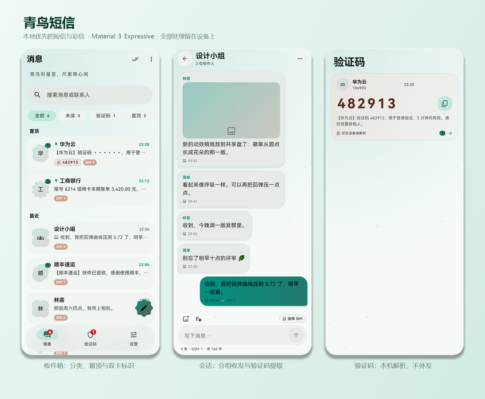
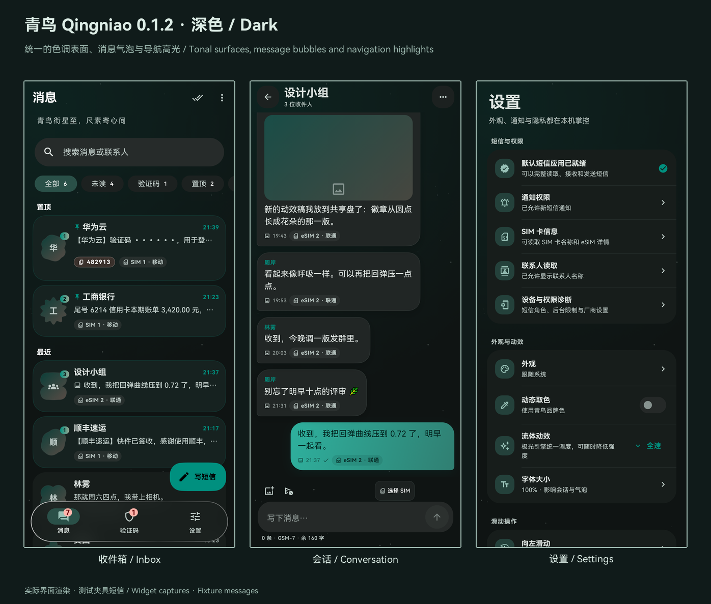
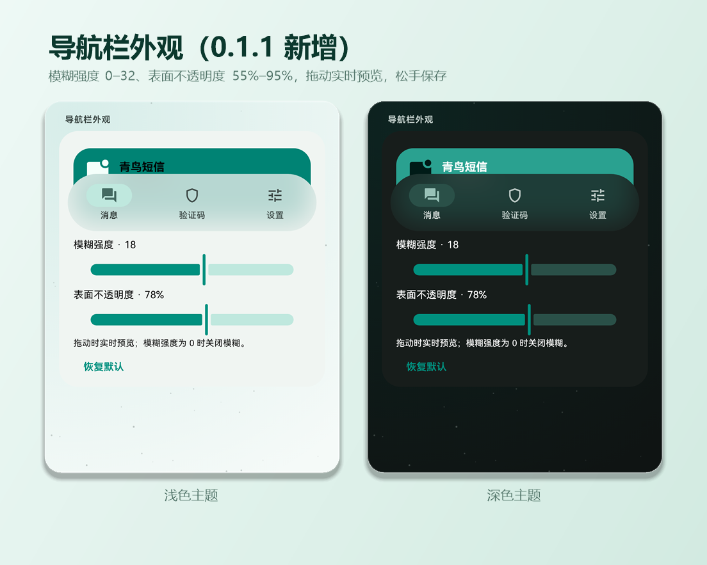

<p align="center">
  
</p>

<h1 align="center">青鸟 · Qingniao</h1>

<p align="center">青鸟衔星至，尺素寄心间</p>
<p align="center">本地优先的 Android 短信与彩信客户端</p>
<p align="center"><strong>简体中文</strong> · <a href="README_EN.md">English</a></p>

青鸟使用 Flutter 构建 Material 3 Expressive 界面，通过 Kotlin 接入 Android 通信能力，以 Rust 实现消息分析、搜索、星空参数生成与密码学模块。短信管理和验证码识别在本机完成；自建同步与网络推送均为可选功能，默认关闭。

| 项目 | 说明 |
| --- | --- |
| 支持平台 | Android 12 及以上（API 31+） |
| 应用包名 | `com.blue.qingniao` |
| 当前源码版本 | **0.1.2** · Android versionCode **4009** |
| 技术栈 | Flutter / Dart · Kotlin · Rust |
| 设计 | Material 3 组件、Expressive 形状与 Aurora 动效 |
| 许可证 | [PolyForm Small Business License 1.0.0](LICENSE) |

**导航：** [界面预览](#界面预览) · [功能](#功能) · [设计与渲染](#设计与渲染) · [开始使用](#开始使用) · [开发与构建](#开发与构建) · [可选联网功能](#可选联网功能) · [安全与兼容性](#安全与兼容性)

## 界面预览

<p align="center">
  
</p>

<p align="center">
  
</p>

<p align="center">
  
</p>

<p align="center"><sub>0.1.2 界面由 <code>test/preview_screens_test.dart</code> 用真实 widget 树离屏渲染，<code>tool/compose_previews.py</code> 排版。会话与 SIM 信息为测试夹具，不是真机短信。</sub></p>

0.1.2 加入持久化收件恢复与 GitHub Release 更新流程，修复手输号码发送和外部短信链接预填，完善每条消息的 SIM/eSIM 来源、滑动圆角、带文字的写短信入口与可关闭的导航高光。接收机制及验证范围见 [可靠性与性能说明](docs/reliability-and-performance.md)；正式 APK 的发布状态以 [GitHub Releases](https://github.com/blueokanna/qingniao/releases) 为准。

<details>
<summary>重新生成预览图（PowerShell）</summary>

从仓库根目录运行。Python 环境需要安装 Pillow。

```powershell
$env:QINGNIAO_RENDER_PREVIEW = '1'
flutter test test/preview_screens_test.dart
Remove-Item Env:QINGNIAO_RENDER_PREVIEW
python tool/compose_previews.py
```

</details>

## 功能

| 模块 | 能力 |
| --- | --- |
| 短信与彩信 | 默认短信角色、双卡/eSIM 来源标识、持久化收件恢复、长短信分段、发送与送达状态、混合 SMS/MMS 会话、群组收件人与附件预览 |
| 会话管理 | 搜索、分页、草稿、多选、置顶、归档、黑名单与可配置滑动操作 |
| 未读管理 | 长按底部「消息」将所有消息标为已读；长按「验证码」仅处理验证码会话；验证码导航角标显示未读数量 |
| 验证码 | 本机提取、一键复制、敏感剪贴板标记与可关闭的阅后回收 |
| 回收站 | 恢复、永久删除与保留期限；无法确认系统删除时保留本地记录 |
| 定时发送 | 持久化任务、系统闹钟、启动及重启恢复；缺少精确闹钟权限时使用降级调度 |
| 通知 | 快捷回复、标为已读、复制验证码；增强通知的最终展示由系统决定 |
| 个性化 | 系统动态取色、六套参考色、深浅主题、AMOLED、导航模糊与高光开关、三种自适应图标与字体选择 |
| 语言与无障碍 | 十种语言资源、RTL、系统字体缩放与减少动态效果支持 |
| 在线更新 | GitHub 正式 Release、前台自动检查、下载进度、包名与签名校验、系统确认安装 |

阅后回收只处理加载时未读、在前台会话中完整显示约两秒的验证码；滚动、切到后台或进入多选会打断计时。批量已读不触发回收，通知到期也不等于删除消息。错过发送时间的定时任务保留待确认，不会在重启后集中补发。

## 设计与渲染

### Material 3 Expressive

界面以 Material 3 组件、色调表面和 Expressive 形状为基础，头像使用缓慢的形状过渡。系统动态取色读取 Android 色阶，在 HCT 色彩空间将彩度调整为原值的 80%，尽量保留色相与明度；最终显示受色域约束。手动参考色板独立于此调整。

底部胶囊使用裁剪范围内的实时高斯背景模糊，直接参与当前画面的合成，不使用背景截图。在「外观 → 导航栏外观」中可设置模糊强度 **0–32**、表面不透明度 **55%–95%**；拖动时预览，松手后保存，强度为 0 时关闭模糊。边缘高光开关控制胶囊轮廓的细白光带，默认开启，并随深浅主题调节亮度；关闭后保留基础轮廓。高对比度模式提高表面遮罩浓度。

### Rust 与 GPU 星空

Rust 根据持久化的安装随机种子生成 **32 × 32 RGBA 参数图**，原始数据为 **4 KiB**，描述星点的位置、远近、亮度、色温与变化尺度。参数图与着色器共享复用，不逐帧调用 Rust。

Flutter `FragmentProgram` 在 GPU 上合成背景与星点。亮度以 64–160 秒、漂移以 240–600 秒为基础时间尺度连续演变，单轴位移不超过 1.2 个逻辑像素，形成细微、缓慢且各不相同的变化。Android 启用 Impeller，由引擎选择设备可用的 GPU 后端；资源加载失败时保留静态 Canvas 回退。

Aurora 将星点与头像的环境更新限制为每秒最多 30 次，交互弹簧仍跟随显示 VSync。省电或减少动态效果时冻结当前星空；AMOLED 保留纯黑底与低亮度星点。退出的标签页在过渡后释放，形状缓存有数量上限，内存压力下清理可释放缓存。

这些是实现机制，并非功耗或帧率的测量结论。性能评估应使用目标设备上的 profile 构建。

## 开始使用

1. 安装与设备架构匹配的 APK。升级已有安装时，必须使用相同签名证书和更高的版本代码。
2. 打开青鸟，通过应用内入口申请系统默认短信角色，并按需授予短信、联系人及通知权限。
3. 在设置中选择 SIM、通知和外观偏好；仅在需要跨设备同步时配置联网功能。

部分 OnePlus / ColorOS 系统版本的默认短信选择器会过滤第三方应用，列表可能为空，即使青鸟已经持有短信角色。可在「设置 → 设备诊断」核对实际角色状态；尚未取得角色时使用应用内的系统申请入口。不要通过卸载或清除数据刷新该列表。

## 工程结构

| 路径 | 职责 |
| --- | --- |
| [`lib/aurora`](lib/aurora) | 主题、公共组件、弹簧、形状与环境动效调度 |
| [`lib/messaging`](lib/messaging) | 会话、验证码、编辑器、彩信与回收站 |
| [`lib/updates`](lib/updates) | 更新检查调度、下载状态与安装入口 |
| [`lib/settings`](lib/settings)、[`lib/sync`](lib/sync) | 设置与同步客户端 |
| [`android/app/src/main/kotlin`](android/app/src/main/kotlin) | 默认角色、Telephony、双卡、通知、权限与任务调度 |
| [`rust/src`](rust/src) | 消息分析、搜索、MMS 编解码、星空参数与密码学模块 |
| [`shaders`](shaders) | GPU 星空着色器 |
| [`server-rs`](server-rs) | 可选的自建同步服务 |
| [`test`](test)、[`integration_test`](integration_test)、[`tool`](tool) | 回归测试、设备测试与构建校验工具 |

系统 SMS/MMS Provider 保存运营商消息；应用存储保存归档、回收站和调度等状态。Android 是唯一维护的应用目标，桌面构建文件用于工具链及宿主机测试，不代表提供桌面客户端。

## 开发与构建

### 环境准备

仓库 [CI 工作流](.github/workflows/android-delivery.yml) 固定 Flutter **3.47.9**、Dart **3.13.7**、Rust **1.99.1** 与 JDK **17**；Android 编译 SDK 为 **36**，CI 安装 NDK **28.2.13676358**，本地 Gradle 使用 Flutter 提供的 NDK 版本。`flutter_rust_bridge` 与代码生成器版本均为 **2.13.0**。校验脚本还需要 Python 3。

安装对应工具链、Android SDK/NDK 并接受 SDK 许可；确保 `flutter`、`dart`、`cargo`、`rustup` 与 `python` 可用。以下命令从仓库根目录执行，使用 PowerShell 语法；其他系统可将 `python` 替换为 `python3`。

```powershell
rustup target add aarch64-linux-android armv7-linux-androideabi x86_64-linux-android
flutter doctor -v
flutter pub get --enforce-lockfile
flutter build apk --debug
```

Debug APK 位于 `build/app/outputs/flutter-apk/app-debug.apk`。性能分析使用 `flutter build apk --profile`，输出为同目录的 `app-profile.apk`；两者均不是正式发布签名。

依赖以仓库锁文件为准。CI 使用固定 Flutter 提交及完整标签历史，通过 [`tool/check_flutter_sdk.py`](tool/check_flutter_sdk.py) 校验 SDK 身份；若出现 `0.0.0-unknown`，应修复 SDK 检出状态与标签，而不是伪造版本或删除依赖约束。

### 检查与测试

```powershell
flutter analyze
flutter test
dart run tool/check_localization.dart
python tool/generate_android_strings.py --check
python tool/check_sms_contract.py
python -m unittest discover -s tool/tests -p 'test_*.py'
cargo test --locked --manifest-path rust/Cargo.toml
cargo test --locked --manifest-path server-rs/Cargo.toml
```

Android 单元测试与 lint 在 `android` 目录执行 `./gradlew testDebugUnitTest lintDebug`；Windows 使用 `gradlew.bat`。APK 原生库对齐检查：

```powershell
python tool/verify_android_pages.py build/app/outputs/flutter-apk/app-debug.apk
```

对齐检查不代替 16 KB 页大小设备上的运行验证。新增更新、SIM 与导航设置文案已补齐十种语言，资源检查覆盖键名与占位符一致性；实际语言体验仍需结合设备布局验收。

修改 Rust 桥接接口后，使用仓库的 Android 生成入口更新绑定：

```powershell
cargo install flutter_rust_bridge_codegen --version 2.13.0 --locked
dart run tool/generate_android_bridge.dart
```

### 真机性能测试

```powershell
$env:ORG_GRADLE_PROJECT_qingniaoBenchmark = 'true'
try {
    flutter drive --profile --driver=test_driver/interface_cadence_driver.dart --target=integration_test/interface_cadence_test.dart -d DEVICE_ID
} finally {
    Remove-Item Env:ORG_GRADLE_PROJECT_qingniaoBenchmark
}
```

将 `DEVICE_ID` 替换为 `flutter devices` 中的设备标识。测试使用独立包名 `com.blue.qingniao.benchmark` 和固定测试数据，不申请短信权限；报告写入 `build/verification/device-interface-cadence.json`。它会覆盖默认 profile 输出，交付普通应用前需重新构建。

### 正式签名与发布

将密钥保存在仓库之外，通过受控环境注入以下变量：

| 环境变量 | 用途 |
| --- | --- |
| `QINGNIAO_KEYSTORE_PATH` | 发布密钥库路径 |
| `QINGNIAO_STORE_PASSWORD` | 密钥库密码 |
| `QINGNIAO_KEY_ALIAS` | 签名密钥别名 |
| `QINGNIAO_KEY_PASSWORD` | 签名密钥密码 |

Windows 发布入口会检查凭据、处理残留插件注册文件并输出产物散列：

```powershell
powershell -File tool/build-release.ps1
# 按架构拆分 APK
powershell -File tool/build-release.ps1 -SplitAbi
# 生成 Android App Bundle
powershell -File tool/build-release.ps1 -Bundle
```

手动运行 Android delivery 工作流可生成生产签名的 APK 和 `update.json`，并创建 Release 草稿。发布为 Latest 后，应用在启动、恢复前台及持续前台使用期间检查更新。常规检查间隔为 5 分钟，检查失败后自动重试间隔为 30 分钟。用户可在设置中立即检查、关闭自动检查，或下载更新并交由 Android 确认安装。签名配置及发布步骤见 [发布与在线更新](docs/releases.md)。

## 可选联网功能

### 自建同步

```powershell
cargo build --release --locked --manifest-path server-rs/Cargo.toml
```

启动生成的服务程序时传入 `--bind 127.0.0.1:8787 --data /path/to/data.json`，将数据路径替换为实际位置，并在前方配置 HTTPS 反向代理及注册访问限制。接口与客户端实现见 [服务端源码](server-rs/src/main.rs) 和 [同步引擎](lib/sync/sync_engine.dart)。设备令牌属于访问凭据，不应写入日志或公开配置。

同步在前台启动、恢复和周期检查时执行，当前不包含 MMS 附件。部署前请阅读下方的安全边界。

### Firebase 网络推送

网络推送用于通知客户端有同步更新，不代替运营商短信传输，需要自行配置真实 Firebase 项目。

1. 在 Firebase 项目中注册 Android 应用 `com.blue.qingniao`，取得 `google-services.json`。
2. 在「设置 → 网络推送」导入配置，核对后保存；也可手动填写项目 ID、项目编号、Android 应用 ID 与公开 API 密钥。导入文件须匹配应用包名，上限为 128 KiB，不接受服务账号私钥。
3. 设备具备 Google Play services 且可连接 Firebase 后，启用推送、配对同步并复制 FID 推送标识。切换已初始化的 Firebase 项目时，先关闭推送，保存新配置，再从系统应用信息强行停止并重新打开青鸟。
4. 在可信发送端安装 `google-auth`、`requests`，配置具有 FCM 发送权限的 Application Default Credentials，再使用 [`tool/send_sync_push.py`](tool/send_sync_push.py)：

   ```powershell
   python tool/send_sync_push.py --project PROJECT_ID --space-id SPACE_ID --installation-id-file PRIVATE_FILE
   ```

上述参数分别替换为实际项目 ID、同步空间 ID，以及保存 FID 的私有文件路径。发布者也可通过 `python tool/configure_firebase.py android/app/google-services.json` 生成内置配置后重新构建。

推送仅携带 `type=sync_available` 和匹配的 `spaceId`，不携带短信正文。前台收到后触发同步；后台显示通用通知，打开应用后同步。服务端不自动登记 FID，标识变化后需更新。保存配置只验证格式，SDK 注册成功后才保存启用状态；实际投递仍须在自己的 Firebase 项目中验证。

## 安全与兼容性

- **运营商通信：** 普通 SMS/MMS 不具有端到端加密。双卡、MMS、送达回执、后台限制和定时发送均需按设备、ROM 与运营商验证。
- **同步加密：** v1 信封使用 X25519、HKDF-SHA256 与 AES-256-GCM；服务器仍可见设备、公钥、路由、密文大小及时间。当前缺少独立发送者认证，私钥尚未由 Android Keystore 包装，公钥信任绑定仍需验收，不能视为已经安全审计的通信协议。
- **功能边界：** Rust P2P 模块提供 Noise 会话层，但尚未接入设备发现、Wi-Fi Direct 或用户可用的发送流程；RCS 未接入。
- **配置保护：** Firebase 配置存于应用私有目录，应用备份关闭；服务端私钥不得导入客户端或提交仓库。
- **验证范围：** 自动化检查、真机运行与安全审计是不同层次的验证。局部设备结果不代表全机型兼容，固定依赖也不等于逐字节可复现构建。

反馈问题时，请附应用版本、Android/ROM 版本、设备型号、复现步骤及脱敏日志；涉及界面问题可附截图。请移除短信正文、电话号码、验证码、令牌和签名凭据。

## 资源与许可证

字体支持系统字体、HarmonyOS Sans 与 Google Sans，中文使用 HarmonyOS Sans 回退。来源和散列见 [字体清单](assets/fonts/manifest.json)，第三方许可见 [assets/licenses](assets/licenses)。十种语言资源位于 [assets/l10n](assets/l10n)。

六套参考色的来源及转换记录见 [色板清单](assets/palettes/coated_reference.json)；屏幕 RGB 色彩不代表经认证的实体 Pantone 专色匹配。

本项目采用 [PolyForm Small Business License 1.0.0](LICENSE)。使用与再分发应遵守该许可证；字体及第三方依赖保留各自的许可条款。
