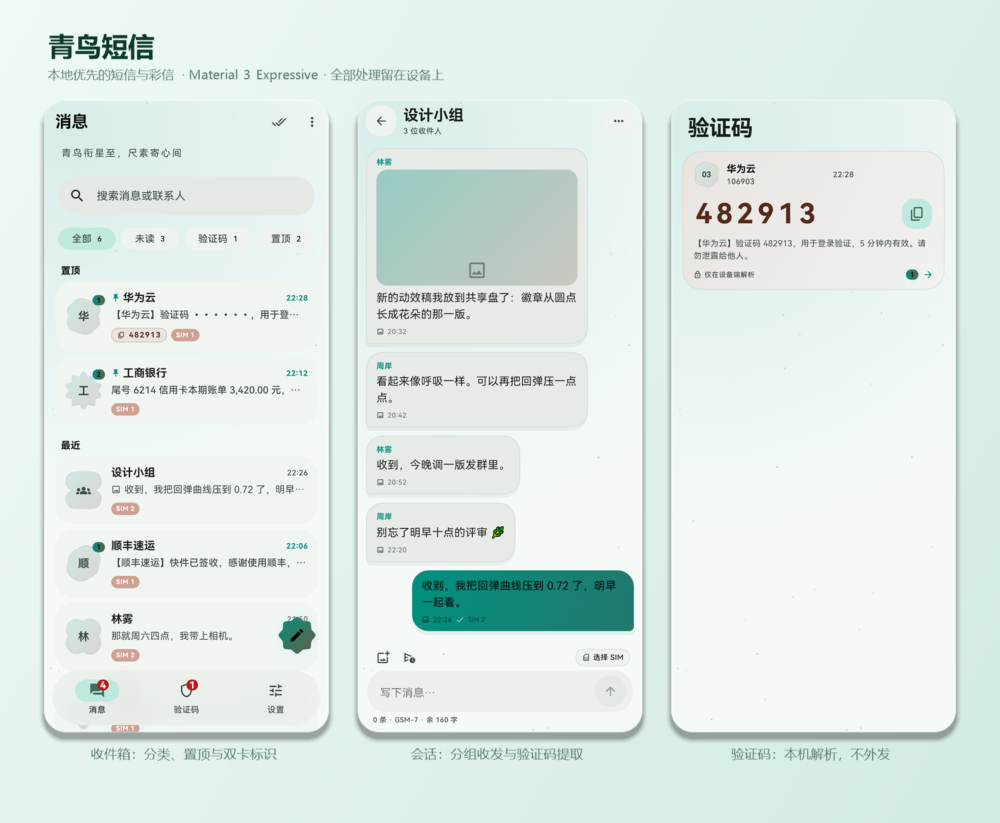
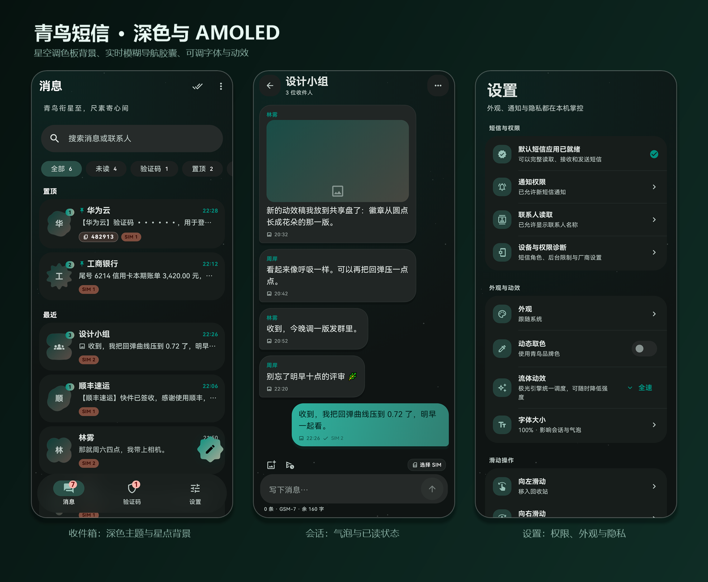
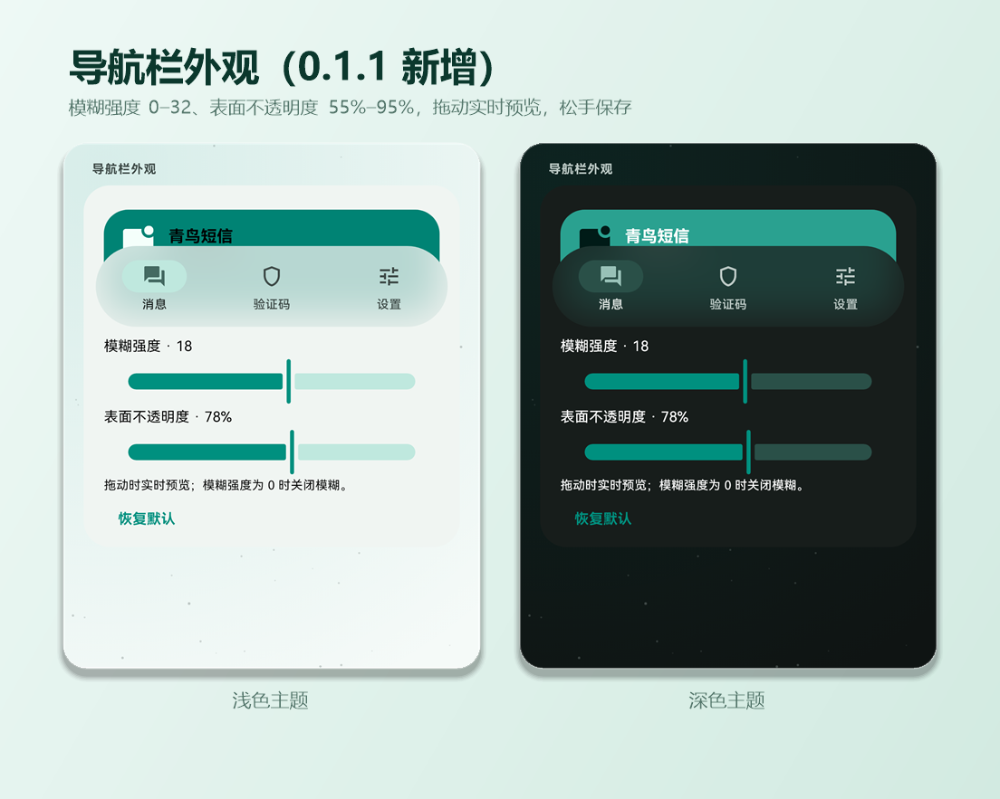

<p align="center">
  
</p>

<h1 align="center">Qingniao · 青鸟</h1>

<p align="center">青鸟衔星至，尺素寄心间</p>
<p align="center">A local-first SMS and MMS client for Android</p>
<p align="center"><a href="README.md">简体中文</a> · <strong>English</strong></p>

Qingniao combines a Flutter Material 3 Expressive interface, Kotlin integration with Android messaging, and Rust modules for message analysis, search, starfield parameters and cryptography. Message management and verification-code extraction run on the device. Self-hosted sync and network push are optional and disabled by default.

| Project | Details |
| --- | --- |
| Supported platform | Android 12 and later (API 31+) |
| Application ID | `com.blue.qingniao` |
| Stack | Flutter / Dart · Kotlin · Rust |
| Design | Material 3 components, Expressive shapes and Aurora motion |
| License | [PolyForm Small Business License 1.0.0](LICENSE) |

**Navigation:** [Screenshots](#screenshots) · [Features](#features) · [Design and rendering](#design-and-rendering) · [Getting started](#getting-started) · [Development and builds](#development-and-builds) · [Optional networking](#optional-networking) · [Security and compatibility](#security-and-compatibility)

## Screenshots

<p align="center">
  
</p>

<p align="center">
  
</p>

<p align="center">
  
</p>

<p align="center"><sub>Rendered off-screen from the real widget tree by <code>test/preview_screens_test.dart</code>; conversation content comes from test fixtures.</sub></p>

## Features

| Area | Capabilities |
| --- | --- |
| SMS and MMS | Default SMS role, dual SIM, multipart messages, send/delivery states, mixed SMS/MMS threads, group recipients and attachment previews |
| Conversations | Search, pagination, drafts, selection, pinning, archiving, blocking and configurable swipe actions |
| Unread messages | Long-press Messages in the bottom navigation to mark all messages read; long-press Codes to handle only code conversations; the Codes badge shows the unread count |
| Verification codes | On-device extraction, one-tap copying, sensitive clipboard marking and optional recycling after reading |
| Trash | Restore, permanent deletion and retention; local records are preserved when provider deletion cannot be confirmed |
| Scheduling | Persistent tasks, system alarms and startup/reboot recovery, with fallback scheduling without exact-alarm access |
| Notifications | Reply, mark read and copy-code actions; the system controls the final presentation of enhanced notifications |
| Personalization | System dynamic colors, six reference palettes, light/dark and AMOLED themes, navigation blur controls, three adaptive icons and font selection |
| Languages and accessibility | Ten language catalogs, RTL, system font scaling and reduced-motion support |

Recycling applies only to codes unread when loaded and fully visible in a foreground conversation for about two seconds. Scrolling, backgrounding or entering selection interrupts the timer. Marking all read does not trigger recycling, and notification expiry does not delete a message. Missed scheduled messages remain available for review instead of being sent in a burst after reboot.

## Design and rendering

### Material 3 Expressive

The interface uses Material 3 components, tonal surfaces and Expressive shapes, with slow avatar morphs. Dynamic colors read Android system tones and reduce chroma to 80% in HCT color space while aiming to retain hue and tone; the final output remains subject to gamut constraints. Manual reference palettes are independent of this adjustment.

The bottom capsule uses clipped, live Gaussian backdrop blur, compositing the current scene rather than a background screenshot. Appearance → Navigation appearance provides a **0–32** blur range and **55%–95%** surface opacity. Changes preview while dragging and persist on release; zero disables blur. High-contrast mode increases the surface overlay opacity.

### Rust and the GPU starfield

Rust generates a **32 × 32 RGBA parameter atlas**, containing **4 KiB** of raw data, from a persisted installation seed. It describes star positions, depth, brightness, tint and evolution scales. The atlas and shader are reused; Rust is not called on every frame.

Flutter `FragmentProgram` composites the background and stars on the GPU. Brightness evolves on a 64–160 second base timescale and drift on a 240–600 second base timescale, with displacement limited to 1.2 logical pixels per axis. Independent, continuous variation produces a subtle and slowly changing sky. Android enables Impeller, with the engine selecting an available GPU backend; a static Canvas fallback remains available if resources fail to load.

Aurora caps ambient star and avatar updates at 30 per second while interaction springs follow display VSync. Power saving and reduced motion freeze the current sky. AMOLED retains faint stars on pure black. Inactive tabs are released after their transition, shape caching is bounded, and memory pressure clears releasable caches.

These are implementation details, not measured power or frame-rate claims. Evaluate performance with profile builds on the target devices.

## Getting started

1. Install an APK matching the device architecture. Updating an existing installation requires the same signing certificate and a higher version code.
2. Open Qingniao and use its in-app flow to request the system default SMS role. Grant messaging, contacts and notification permissions as needed.
3. Choose SIM, notification and appearance preferences in settings. Configure networking only if cross-device synchronization is needed.

Some OnePlus / ColorOS versions filter third-party apps from the default SMS selector, leaving the list empty even when Qingniao holds the SMS role. Check the actual role in Settings → Device diagnostics; if it has not been granted, use the in-app system request flow. Do not uninstall or clear data to refresh this list.

## Project structure

| Path | Responsibility |
| --- | --- |
| [`lib/aurora`](lib/aurora) | Themes, shared components, springs, shapes and ambient scheduling |
| [`lib/messaging`](lib/messaging) | Conversations, codes, composer, MMS and trash |
| [`lib/settings`](lib/settings), [`lib/sync`](lib/sync) | Settings and sync client |
| [`android/app/src/main/kotlin`](android/app/src/main/kotlin) | Default roles, Telephony, SIMs, notifications, permissions and scheduling |
| [`rust/src`](rust/src) | Message analysis, search, MMS codecs, starfield parameters and cryptographic modules |
| [`shaders`](shaders) | GPU starfield shader |
| [`server-rs`](server-rs) | Optional self-hosted sync service |
| [`test`](test), [`integration_test`](integration_test), [`tool`](tool) | Regression tests, device tests and build verification tools |

Android SMS/MMS providers hold carrier messages; app storage holds archive, trash and scheduling state. Android is the only maintained application target. Desktop build files support toolchains and host tests, not a desktop client.

## Development and builds

### Prerequisites

The [CI workflow](.github/workflows/android-delivery.yml) pins Flutter **3.47.9**, Dart **3.13.7**, Rust **1.99.1** and JDK **17**. The Android compile SDK is **36**. CI installs NDK **28.2.13676358**; local Gradle builds use Flutter's configured NDK version. Both `flutter_rust_bridge` and its generator use **2.13.0**. Verification scripts also require Python 3.

Install the matching toolchains and Android SDK/NDK, and accept the SDK licenses. Ensure `flutter`, `dart`, `cargo`, `rustup` and `python` are available. Commands below run from the repository root and use PowerShell syntax; on other systems, use `python3` where appropriate.

```powershell
rustup target add aarch64-linux-android armv7-linux-androideabi x86_64-linux-android
flutter doctor -v
flutter pub get --enforce-lockfile
flutter build apk --debug
```

The debug APK is written to `build/app/outputs/flutter-apk/app-debug.apk`. For profiling, run `flutter build apk --profile`, which produces `app-profile.apk` in the same directory. Neither uses production signing.

Use the repository lockfiles. CI checks out a fixed Flutter commit with complete tag history and validates SDK identity through [`tool/check_flutter_sdk.py`](tool/check_flutter_sdk.py). If the SDK reports `0.0.0-unknown`, repair its checkout and tags rather than fabricating version metadata or removing dependency constraints.

### Checks and tests

```powershell
flutter analyze
flutter test
dart run tool/check_localization.dart
python tool/generate_android_strings.py --check
python tool/check_sms_contract.py
python -m unittest discover -s tool/tests -p 'test_*.py'
cargo test --locked --manifest-path rust/Cargo.toml
cargo test --locked --manifest-path server-rs/Cargo.toml
```

Run `./gradlew testDebugUnitTest lintDebug` from `android` for native tests and lint; use `gradlew.bat` on Windows. To inspect native library alignment in the APK:

```powershell
python tool/verify_android_pages.py build/app/outputs/flutter-apk/app-debug.apk
```

Alignment checks do not replace runtime validation on a device with 16 KB pages. Localization checks cover key and placeholder consistency across ten catalogs, not translation completeness; some newer settings use English fallback outside Chinese and English.

After changing a Rust bridge interface, regenerate bindings through the repository's Android entry point:

```powershell
cargo install flutter_rust_bridge_codegen --version 2.13.0 --locked
dart run tool/generate_android_bridge.dart
```

### Device performance tests

```powershell
$env:ORG_GRADLE_PROJECT_qingniaoBenchmark = 'true'
try {
    flutter drive --profile --driver=test_driver/interface_cadence_driver.dart --target=integration_test/interface_cadence_test.dart -d DEVICE_ID
} finally {
    Remove-Item Env:ORG_GRADLE_PROJECT_qingniaoBenchmark
}
```

Replace `DEVICE_ID` with an identifier from `flutter devices`. This uses the isolated package `com.blue.qingniao.benchmark`, fixed test data and no SMS permissions. The report is written to `build/verification/device-interface-cadence.json`. It overwrites the default profile output; rebuild the normal app before delivery.

### Production signing and releases

Keep signing keys outside the repository and inject these variables through a controlled environment:

| Environment variable | Purpose |
| --- | --- |
| `QINGNIAO_KEYSTORE_PATH` | Release keystore path |
| `QINGNIAO_STORE_PASSWORD` | Keystore password |
| `QINGNIAO_KEY_ALIAS` | Signing key alias |
| `QINGNIAO_KEY_PASSWORD` | Signing key password |

The Windows release script validates credentials, handles stale plugin registration files and prints artifact hashes:

```powershell
powershell -File tool/build-release.ps1
# Build separate APKs for each ABI
powershell -File tool/build-release.ps1 -SplitAbi
# Build an Android App Bundle
powershell -File tool/build-release.ps1 -Bundle
```

Release builds fail without signing credentials instead of falling back to development signing. Update the version code in `pubspec.yaml` before release and verify the final certificate, SHA-256 and artifact. Do not run tests that update plugin registration concurrently with a release build. CI produces verification artifacts and can create a draft Release through a manual workflow; consult the workflow for its inputs.

## Optional networking

### Self-hosted sync

```powershell
cargo build --release --locked --manifest-path server-rs/Cargo.toml
```

Start the generated service executable with `--bind 127.0.0.1:8787 --data /path/to/data.json`, replacing the data path with your actual location. Deploy behind an HTTPS reverse proxy and restrict registration access. See the [server source](server-rs/src/main.rs) and [sync engine](lib/sync/sync_engine.dart) for the API and client implementation. Device tokens are credentials and must not appear in logs or public configuration.

Sync runs on foreground startup, resume and periodic foreground checks. MMS attachments are currently excluded. Review the security boundaries below before deployment.

### Firebase network push

Network push tells the client that sync updates are available. It does not replace carrier SMS transport and requires your own Firebase project.

1. Register the Android application `com.blue.qingniao` in Firebase and obtain `google-services.json`.
2. Import it in Settings → Network push, review the fields and save. Manual entry accepts the project ID, project number, Android app ID and public API key. Imports must match the package, are limited to 128 KiB and reject service-account private keys.
3. With Google Play services and Firebase connectivity available, enable push, pair sync and copy the FID push identifier. To switch an initialized Firebase project, disable push first, save the new configuration, then force-stop Qingniao from system app information and reopen it.
4. On a trusted sender, install `google-auth` and `requests`, configure Application Default Credentials with FCM send permission, and use [`tool/send_sync_push.py`](tool/send_sync_push.py):

   ```powershell
   python tool/send_sync_push.py --project PROJECT_ID --space-id SPACE_ID --installation-id-file PRIVATE_FILE
   ```

Replace the arguments with the actual project ID, sync space ID and path to a private file containing the FID. Publishers can also generate bundled configuration with `python tool/configure_firebase.py android/app/google-services.json` and rebuild.

Push payloads contain only `type=sync_available` and the matching `spaceId`, never message bodies. Foreground delivery triggers sync; background delivery shows a generic notification, with synchronization when the app opens. The server does not automatically register FIDs; update changed identifiers. Saving configuration validates its format; push is marked enabled only after successful SDK registration. Verify actual delivery against your own Firebase project.

## Security and compatibility

- **Carrier messaging:** Ordinary SMS/MMS is not end-to-end encrypted. Dual SIM, MMS, delivery receipts, background restrictions and scheduling require device, ROM and carrier validation.
- **Sync encryption:** Version-1 envelopes use X25519, HKDF-SHA256 and AES-256-GCM. The server still sees devices, public keys, routing, ciphertext sizes and timing. Independent sender authentication is missing, private keys are not yet wrapped by Android Keystore, and public-key trust binding needs validation. This is not an audited messaging protocol.
- **Feature boundaries:** The Rust P2P module provides a Noise session layer, but discovery, Wi-Fi Direct and a user-facing sending flow are not integrated. RCS is not integrated.
- **Configuration:** Firebase configuration is stored in private app storage, with app backup disabled. Never import server private keys into the client or commit them to the repository.
- **Validation scope:** Automated checks, device testing and security audits provide different evidence. Results from selected devices do not establish universal compatibility; pinned dependencies alone do not establish byte-for-byte reproducibility.

When reporting a problem, include the app version, Android/ROM version, device model, reproduction steps and sanitized logs. Screenshots help with interface issues. Remove message bodies, phone numbers, verification codes, tokens and signing credentials.

## Resources and license

Font choices include the system font, HarmonyOS Sans and Google Sans, with HarmonyOS Sans fallback for Chinese. See the [font manifest](assets/fonts/manifest.json) for origins and hashes, and [assets/licenses](assets/licenses) for third-party notices. The ten language catalogs live in [assets/l10n](assets/l10n).

The [palette manifest](assets/palettes/coated_reference.json) records the six reference colors and their conversion provenance. Screen RGB output is not a certified physical Pantone spot-color match.

This project is licensed under the [PolyForm Small Business License 1.0.0](LICENSE). Use and redistribution must comply with its terms; fonts and third-party dependencies retain their respective licenses.
